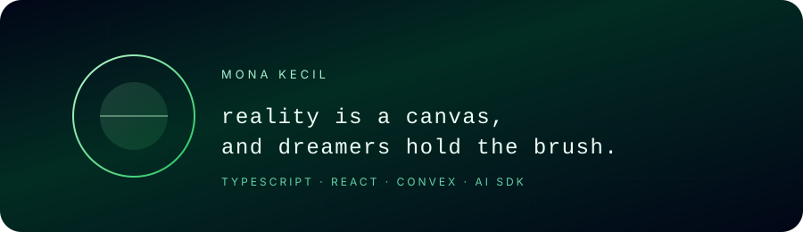

<p align="center">
  
</p>

<p align="center">
  <sub>
    reality engineer · typescript / react / convex / ai-sdk · matcha in hand
  </sub>
</p>

---

> Reality is a canvas,  
> and dreamers hold the brush.

<br />

<h3 align="right">now</h3>

<div align="right">

```yaml
name: Mona
location: somewhere on earth
current_focus:
  - playful tools with TypeScript
  - ambient interfaces for humans + AI
brewing: matcha, ideas, tiny experiments
```

</div>

---

### stack

```text
TypeScript   · React
Convex       · AI SDK
```

I like building small, dreamy interfaces where AI feels like a quiet collaborator  
—not the main character.

---

### small garden of projects

- **[bud](https://github.com/Mona-kecil/bud)**  
  🌱 a seedling – tiny experiments growing into something useful

- **[experimental-bincang](https://github.com/Mona-kecil/experimental-bincang)**  
  💬 conversations as a playground for language + interfaces

---

### matcha / meta

- 🍵 matcha > coffee
- 💙 TypeScript is my matcha – I reach for it first
- 🌀 I like interfaces that feel more like atmospheres than dashboards

---

### elsewhere

↳ [kecil.dev](https://kecil.dev) · [x.com/2045humanoid](https://x.com/2045humanoid) · [linkedin.com/in/mona-kecil](https://linkedin.com/in/mona-kecil)
